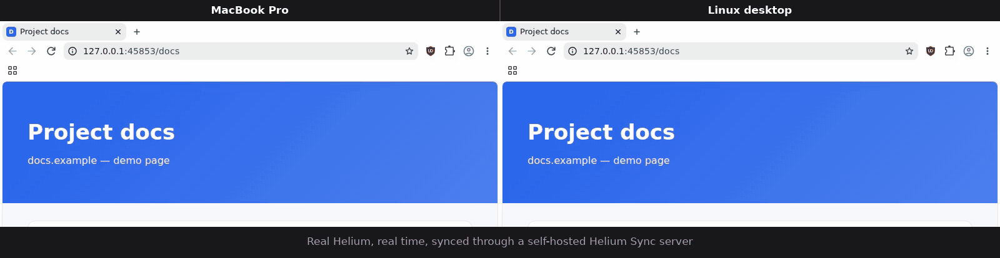
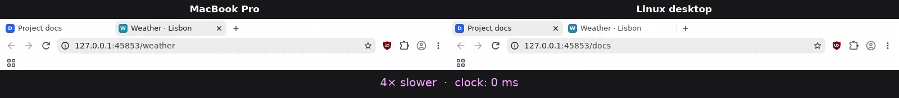
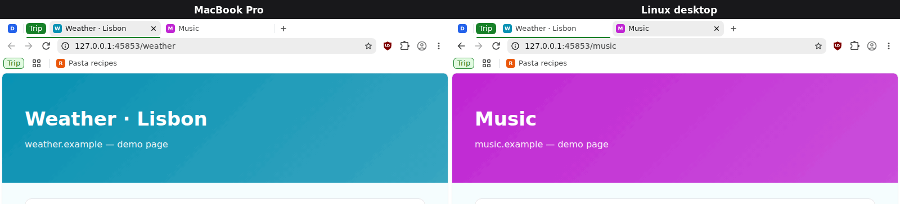

# Helium Sync

Self-hosted, end-to-end encrypted sync for the [Helium](https://helium.computer) browser. It works like Chrome's sync service (bookmarks, history, open tabs, extensions, reading list, send-tab) and adds **Arc-style live tabs**: a window's tabs mirror across your machines in real time (about 80 ms end to end on a LAN).

- **Server:** one static Go binary with SQLite inside. Runs on Linux, macOS, Windows and FreeBSD, or in Docker.
- **Client:** an MV3 extension that your server builds, signs and hosts. A one-line "tweak" script installs it on macOS, Linux or Windows, and it then updates itself from your server.
- **Private:** everything is encrypted in the browser. The server stores ciphertext and never sees your password or keys.

Created in [T3 Code](https://t3.codes).

## See it sync

Two real Helium windows ("MacBook Pro" on the left, "Linux desktop" on the right), each with its own profile, synced through a self-hosted server. Recorded in real time, nothing sped up:



Each caption shows how long the action took to show up in the *other* browser's tab list (84–221 ms). That's measured by the recording script polling the browser, so it's an upper bound. Frame by frame (30 fps), the other window repaints within 0–8 frames of the window where the action happened; often in the same frame.

Opening a tab, slowed down 4×: the left window's address bar changes at about 316 ms, the new tab appears on the **right** at 350 ms, and the left window draws its own new tab at 383 ms.



<table>
<tr>
<td width="62%"></td>
<td width="38%"></td>
</tr>
<tr>
<td>Both windows end up identical: the pinned tab, the "Trip" group, the tabs, and the bookmark.</td>
<td>The popup: live-tab status, and the tabs open on your other devices.</td>
</tr>
</table>

<details>
<summary>Settings page</summary>


</details>

The demo is reproducible: [`test/demo/record.mjs`](test/demo/record.mjs) drives the two browsers on an X display and records with ffmpeg; [`test/demo/encode.mjs`](test/demo/encode.mjs) turns the recording into these GIFs (about 700 KB together).

---

## Quick start

### 1. Run the server

**Docker + Caddy (automatic HTTPS):** edit the domain in [`deploy/docker-compose.yml`](deploy/docker-compose.yml), then run:

```sh
cd deploy && docker compose up -d
docker compose logs helium-sync     # prints your first invite code
```

**Single binary:**

```sh
make build                          # or: go build -o bin/helium-sync ./cmd/helium-sync
./bin/helium-sync serve --acme-domain sync.example.com    # built-in Let's Encrypt (ports 80/443)
# or behind your own proxy:
./bin/helium-sync serve --addr 127.0.0.1:8080 --public-url https://sync.example.com --trust-proxy
```

**In the background, on any OS** (Linux, macOS, Windows; including Raspberry Pi and other home hardware):

```sh
helium-sync service install --addr :8080            # systemd · launchd · Windows service (elevated PowerShell)
helium-sync service status
helium-sync service uninstall                       # keeps your data
```

It starts at boot, restarts on failure, and runs at background priority. There's also a hardened [systemd unit](deploy/helium-sync.service) for manual setups and a [Caddyfile](deploy/Caddyfile). On a private network or Tailscale, plain `--addr :8080` works too. Data is end-to-end encrypted either way, but use HTTPS on the open internet so sign-in tokens can't be intercepted.

While no account exists, the server prints a fresh single-use **invite code** at every start:

```
  │  Invite code for the first account:  7KQ2-M9XD-4PWA
  │    macOS/Linux:  curl -fsSL https://sync.example.com/tweak.sh | sh
  │    Windows:      irm https://sync.example.com/tweak.ps1 | iex
```

### 2. Connect Helium (on every machine)

**Quit Helium**, then run the line for your OS (also shown at `https://your-server/`):

| OS | Command |
|---|---|
| macOS / Linux | `curl -fsSL https://sync.example.com/tweak.sh \| sh` |
| Windows (PowerShell) | `irm https://sync.example.com/tweak.ps1 \| iex` |

Helium opens your server's install page. Click **Add extension**. The setup page opens with your server already filled in: create your account (with the invite code) on the first machine, and sign in on the others.

What the tweak does: it switches on Helium's built-in flag `chrome://flags/#extension-mime-request-handling` → *Always prompt for install* by editing `Local State` (with a backup), then opens the install page. That flag is what lets Helium install an extension from somewhere other than the Web Store. Nothing else is changed. `sh tweak.sh --undo` (or `HELIUM_SYNC_UNDO=1` on Windows) restores the backup. If you prefer Developer mode, `sh tweak.sh --unpacked` downloads the extension for *Load unpacked*.

---

## What syncs

| Data | How |
|---|---|
| **Live tabs** | One window per device mirrors in real time: open, close, navigate, pin, reorder, tab groups (name, colour, collapsed). Two modes, chosen account-wide: **All tabs**, or **Pinned & grouped** (Arc-style; everything else stays local). Tabs from other devices can load lazily (discarded until you open them). |
| **Bookmarks** | Full tree: folders, order, renames, moves, deletes. The first sync merges identical bookmarks instead of duplicating them. |
| **History** | New visits on one device appear in the others' history within seconds. Everything synced also goes into an encrypted local archive with a search page. Clearing history on one device clears it everywhere. |
| **Open tabs** | See what's open on your other devices (popup), and open any of it here. |
| **Send tab** | Right-click a page or link → *Send to your devices*. Delivered instantly if the device is online, otherwise the next time it connects. |
| **Extensions** | Installed list and on/off state. Extensions missing on a device are offered with one-click install from the store. |
| **Reading list** | Add, mark read, remove. |

Each type can be switched off per device. Devices can be renamed and remotely signed out.

---

## How it works

```
 Helium (device A)                         your server                         Helium (device B)
 ┌───────────────────────┐   WebSocket   ┌──────────────────┐   WebSocket   ┌───────────────────────┐
 │ adapters: tabs, bm, … │──── push ────▶│ SQLite: opaque   │──changes────▶│ adapters apply only   │
 │ scan ▸ diff ▸ encrypt │◀── changes ───│ (coll, id, seq,  │◀──── push ────│ fields that changed   │
 │ AES-256-GCM per record│               │  ciphertext)     │               │ decrypt ▸ merge       │
 └───────────────────────┘               └──────────────────┘               └───────────────────────┘
```

**Server.** A record is an opaque `(collection, id, ciphertext)` triple. Every write gets the next value of a per-user sequence number, and clients sync from a cursor. All frames to a connection are produced under the user's lock, in sequence order. A connection only receives live changes once it has caught up, so a client never sees a gap or an older version after a newer one. Pushes fan out to your other devices in about 1 ms (`go test -bench Fanout`).

**Client engine.** Every data type is reconciled by *state*, not by replaying events:

- `scan` reads the browser, diffs it against the last-synced model, and queues the differences.
- `apply` merges remote records and changes only what they changed.

Because the browser's own events after an apply lead to a scan that finds nothing new, there are no echo loops, whatever order Chromium delivers events and callbacks in. Changes made offline wait in a persisted outbox.

**Conflicts.** Each field (URL, title, pin, group, position, bookmark parent…) carries its own version: a hybrid-logical-clock stamp plus the device id. Merges take the newest value per field. So if one device renames a tab group while another moves a tab, both changes survive. A device that hadn't yet seen a newer change can never roll it back, and merges converge in any order. Ordering uses fractional index keys, so a move rewrites one record.

**Live tabs in Helium specifically:**

- Helium pins are profile-wide and mirrored into every window, so only one window per device is mirrored and pin copies elsewhere are ignored.
- Tab ids don't survive restarts, so tabs are re-matched to records by URL once session restore settles.
- Closing a window or quitting never deletes tabs. A tab deleted elsewhere while this device was off is closed when its restored copy reappears.
- Redirects (`webNavigation` qualifiers) aren't synced back, so device-specific redirects (login pages, locales) can't make devices fight.
- Titles are reported only by the device that navigated the tab, so loading placeholders and unread counts don't flip-flop.

---

## Security model

```
password ─PBKDF2-SHA256 (600k, per-user salt)─▶ master ─HKDF─┬─▶ authKey  → server stores Argon2id(authKey)
                                                             └─▶ kek      (never leaves the device)
dataKey (random 256-bit, stored on the server wrapped with kek)
dataKey ─HKDF─┬─▶ AES-256-GCM record key   (fresh IV; AAD = collection + record id)
              └─▶ HMAC-SHA256 id key       (URLs etc. become opaque record ids)
```

- **What the server sees:** usernames, device names, collection names (`bm`, `h`, `lt`, …), record counts and sizes, timestamps. **What it doesn't see:** URLs, titles, bookmarks, history, tabs, your password or any key. A full database leak yields ciphertext plus slow-to-attack verifiers. Ciphertext is bound to its record, so the server can't swap or replay records between ids or collections.
- **Keys** live in the browser as non-extractable WebCrypto keys (IndexedDB). Changing the password re-wraps the data key (nothing is re-encrypted) and signs out other devices. **If you forget your password, the data can't be recovered.** That's what end-to-end means; just sign up again.
- **Sessions:** 256-bit bearer tokens, stored hashed (SHA-256). Revocable from any device or the CLI. The WebSocket authenticates in its first frame (no tokens in URLs or proxy logs) and rejects website origins.
- **Abuse limits:** per-IP rate limiting on auth, per-account failed-login lockout, bounded Argon2 concurrency, request/record size limits, per-account storage quota (default 1 GiB).
- **Registration:** invite codes by default (`open`/`closed` also available). Prelogin returns a stable fake salt for unknown users, so usernames can't be enumerated.
- **Extension:** no host permissions (the server allows CORS from extension origins only, which is safe because tokens aren't cookies). Only its own pages can talk to the service worker. Content from other devices is rendered as text, and only web URLs become links.

---

## Server reference

```
helium-sync serve   [flags]                 run the server
helium-sync invite  [--uses N] [--ttl 168h] create an invite code
helium-sync users                           list accounts
helium-sync devices <username>              list an account's devices
helium-sync revoke  <device-id>             sign a device out
helium-sync delete-user <username>          delete an account and its data
```

| Flag | Env | Default |
|---|---|---|
| `--data` | `HELIUM_SYNC_DATA` | `./data` |
| `--addr` | `HELIUM_SYNC_ADDR` | `:8080` (`:443` with ACME) |
| `--public-url` | `HELIUM_SYNC_PUBLIC_URL` | derived from requests |
| `--registration` | `HELIUM_SYNC_REGISTRATION` | `invite` (`open`, `closed`) |
| `--acme-domain`, `--acme-email` | `HELIUM_SYNC_ACME_DOMAIN`, `…_EMAIL` | off |
| `--tls-cert`, `--tls-key` | `HELIUM_SYNC_TLS_CERT`, `…_KEY` | off |
| `--trust-proxy` | `HELIUM_SYNC_TRUST_PROXY` | `false` |
| `--quota-mb` | `HELIUM_SYNC_QUOTA_MB` | `1024` |
| `--history-days` | `HELIUM_SYNC_HISTORY_DAYS` | `90` |
| `--tombstone-days` | `HELIUM_SYNC_TOMBSTONE_DAYS` | `180` |
| `--memory-limit-mb` | `HELIUM_SYNC_MEMORY_LIMIT_MB` | `64` (soft GC target) |
| `--log-file` | `HELIUM_SYNC_LOG_FILE` | stderr |

The default data directory is per user: `~/.local/share/helium-sync` (Linux; `/var/lib/helium-sync` as root), `~/Library/Application Support/helium-sync` (macOS), `%LOCALAPPDATA%\helium-sync` (Windows; `%ProgramData%\helium-sync` for the Windows service). It holds `helium-sync.db` (SQLite, WAL) and `extension-key.pem`. That key signs your extension builds and fixes the extension ID, so **back it up** along with the database. Upgrading the server binary also ships the bundled extension, and installed copies update themselves via `/ext/updates.xml`.

---

### Footprint

Measured on Linux x86-64. The server is a single ~15 MB static binary with no runtime dependencies (amd64/arm64/armv7 builds for Linux, macOS, Windows, FreeBSD).

| | |
|---|---|
| Memory at start / idle with 10 devices connected | 16 MB / 20 MB |
| Peak memory: a login plus 50,000 records fanned out to 19 devices | 38 MB |
| CPU while idle with 10 devices connected | ~40 ms per minute (0.07% of a core) |
| Disk | roughly payload + one index. The client compresses large records (e.g. open-tab lists) before encrypting, history expires after 90 days, tombstones after 180, and freed space goes back to the filesystem |

How it stays small: 2 MiB SQLite cache per connection; readers opened on demand and closed when idle; the WAL truncated to 4 MiB; a soft Go memory target. Logins hash with Argon2id at 19 MiB (one OWASP profile, on top of the client's 600k PBKDF2 rounds), and that memory is returned to the OS afterwards. Device activity is written at most every 10 minutes. The schema is migrated in place by version number, so older databases open in newer servers.

## Compatibility

Helium Sync uses only stable extension APIs and checks for each optional one at runtime. A missing or changed API turns off just the feature that needs it (shown in settings), never the whole extension.

- **Browsers.** The end-to-end suites pass on the oldest Helium (0.3.5.1, Chromium 139), the current Helium (0.22.2, Chromium 158), and Chrome for Testing 120 (the declared minimum), 145, 150, 156 and 159.
- **Lazy-loading tabs** from other devices relies on tab discarding, which brought the whole browser down on Chromium 120–155 in our (headless) tests and works from 156. It is only enabled on 156 and newer; older versions load those tabs normally, and the setting says why.
- **Mixed extension versions.** Records carry a format number (plain or compressed). Fields a device doesn't know are kept when it rewrites a record. Records in a format newer than a device understands are skipped and fetched again once that device has updated, which happens automatically from your server. A loop breaker sends a record that is rewritten more than 120 times a minute at most every 5 s (deletions are never held), so a browser quirk can't turn into runaway traffic.
- **Browser quirks handled:** duplicate bookmark roots (local plus account storage); tab-group colours a browser lacks (shown as grey but not overwritten); visit events whose number and timing differ between versions (this caused an endless history echo on Chromium 139 before it was fixed); service-worker restarts at any time; a window opened before session restore finishes on startup.
- **Server and protocol.** `/api/v1` is versioned and the WebSocket handshake carries a protocol number. Unknown messages and fields are ignored on both sides, so additions don't break older clients.

## Limitations (honest)

- **Passwords, autofill and browser settings** aren't synced: Chromium gives extensions no API for them.
- **History timestamps:** `history.addUrl` can only record a visit *now*, without a title. So visits from other devices are added to Helium's history while they're fresh (≤30 min). Older ones live in the extension's searchable *Synced history* page.
- **Extensions** can't install other extensions, so missing ones are one click away rather than automatic.
- **Installing** needs the Helium flag above (the tweak sets it) or Developer mode. Helium only gives Web Store extensions a silent install.
- Helium is building native "extension-backed" sync (a `syncVaultProvider` API in its source, behind a disabled flag in 0.22). When it ships, this server's object store could become a provider for it, which would add passwords and settings. That's the natural next step.

---

## Development

```sh
make test                                  # Go (race detector) + JS unit tests
HELIUM=/path/to/helium make e2e            # end-to-end: real server + two real browsers
HELIUM=/path/to/helium make perf           # timings
```

The end-to-end suites run the actual server binary and two (or three) headless browser profiles with the extension, and verify:

- bookmarks create/nest/rename/reorder/delete
- live tabs open/navigate/pin/group/reorder/close
- redirects aren't echoed
- history, open tabs and send-tab
- first-sync merge without duplicates
- offline edits across a server outage
- browser restart while the other device keeps changing things
- a third device catching up
- **quiescence**: after things settle, no device writes anything (no echo or ping-pong loops)

They pass on every browser listed under *Compatibility*. `HS_TRACE=1` dumps a full trace on failure.

Measured on Helium 0.22.2, localhost, headless:

| | |
|---|---|
| New tab on A appears on B | ~75–80 ms (perf median ~120 ms incl. polling) |
| 5,000 bookmarks in 50 folders | on B 2.2 s after A finished creating them |
| History backfill, 5,000 visits | encrypted + uploaded in 1.5 s |
| New device fully synced | ~0.7 s, including 600k-iteration key derivation |
| Server push → other device | ~1 ms; SQLite 40k writes/s, 115k reads/s |

```
cmd/helium-sync/     CLI and server entry point
internal/server/     HTTP API, auth, WebSocket hub, static pages
internal/store/      SQLite storage
internal/crx/        CRX3 signing and verification
internal/extpack/    builds per-server extension packages
extension/           the MV3 extension (no build step)
  src/engine.js        outbox, ordered apply, catch-up
  src/collections/     bookmarks, live tabs, history, extensions, …
  src/lib/             crypto, connection, ordering keys, IndexedDB
web/                 landing page, install page, tweak scripts
test/unit, test/e2e  tests
deploy/              Docker Compose, Caddy, systemd
```
