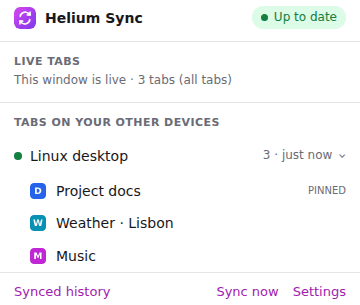
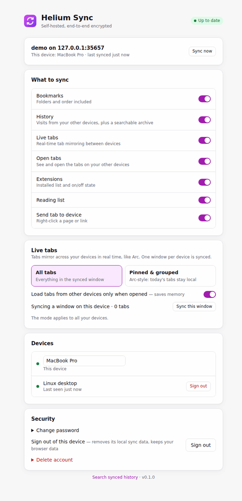

# Helium Sync

Self-hosted, end-to-end encrypted sync for the [Helium](https://helium.computer) browser. It works like Chrome sync (bookmarks, history, open tabs, extensions, reading list, send-tab) and adds **Arc-style live tabs**: a window's tabs mirror across your computers in real time.


<sub>Two real Helium windows with separate profiles, synced through a self-hosted server, recorded in real time. Captions show how long each change took to reach the other browser.</sub>

- **Fast:** changes reach your other devices in about 0.1–0.2 s.
- **Private:** everything is encrypted in the browser. The server only stores ciphertext and never sees your password.
- **Light:** one ~15 MB binary using ~20 MB of RAM. Runs on Linux, macOS, Windows or a Raspberry Pi.
- **Easy:** a one-line install for the server, a one-line tweak for each Helium. The extension then updates itself from your server.

## Quick start

**1. Install the server** on a machine that stays on:

```sh
# Linux / macOS
curl -fsSL https://raw.githubusercontent.com/j4ckxyz/helium-sync-server/main/scripts/install-server.sh | sh
```
```powershell
# Windows (PowerShell)
irm https://raw.githubusercontent.com/j4ckxyz/helium-sync-server/main/scripts/install-server.ps1 | iex
```

**2. Run it in the background**, choosing how your devices reach it:

```sh
helium-sync service install --acme-domain sync.example.com        # public domain, automatic HTTPS
helium-sync service install --addr 127.0.0.1:8080 --trust-proxy \
    --public-url https://sync.example.com                         # behind Caddy/nginx
helium-sync service install --addr :8080 --insecure-http \
    --public-url http://100.101.102.103:8080                      # private network (LAN, Tailscale)
```

The first invite code is in the server log (see [docs/server.md](docs/server.md#run-in-the-background)).

**3. Connect Helium** on each computer. Quit Helium, then run:

```sh
# macOS / Linux
curl -fsSL https://raw.githubusercontent.com/j4ckxyz/helium-sync-server/main/scripts/tweak.sh | sh -s -- --server https://sync.example.com
```
```powershell
# Windows (PowerShell)
$env:HELIUM_SYNC_SERVER='https://sync.example.com'; irm https://raw.githubusercontent.com/j4ckxyz/helium-sync-server/main/scripts/tweak.ps1 | iex
```

Helium opens your server's install page: click **Install extension**, then **Add extension**. Create your account with the invite code, then sign in on your other computers.

The tweak changes one thing: it turns on Helium's own *Always prompt for install* flag (`chrome://flags/#extension-mime-request-handling`), which Helium needs before it will install an extension from outside the Web Store. It keeps a backup, and `--undo` restores it.

## Let an agent set it up

Paste this into Claude Code, Codex or another coding agent on the machine that will run the server:

```text
Set up Helium Sync (https://github.com/j4ckxyz/helium-sync-server) for me: a self-hosted,
end-to-end encrypted sync server for the Helium browser. Read and follow
https://raw.githubusercontent.com/j4ckxyz/helium-sync-server/main/docs/agent-setup.md step by step.
Ask me how my devices should reach the server before choosing, ask before exposing anything to
the internet, and leave creating my account and choosing my password to me.
```

## What syncs

| | |
|---|---|
| **Live tabs** | One window per device, mirrored in real time: open, close, navigate, pin, reorder, tab groups. Either **all tabs**, or **pinned & grouped** only (Arc-style). |
| **Bookmarks** | The full tree. The first sync merges identical bookmarks instead of duplicating them. |
| **History** | New visits appear on your other devices, plus a searchable archive of everything synced. |
| **Open tabs & send tab** | See what's open on your other devices; right-click to send a page to any device. |
| **Extensions** | Your extension list and on/off state; extensions missing on a device are one click away. |
| **Reading list** | Saved for later, everywhere. |

<table>
<tr>
<td width="62%"></td>
<td width="38%"></td>
</tr>
</table>

<details>
<summary>Slow motion: how fast is it really?</summary>

Opening a tab, slowed down 4×: the left window's address bar changes at about 316 ms, the new tab appears on the **right** at 350 ms, and the left window draws its own new tab at 383 ms. In other words, the other computer keeps up with the browser's own drawing.


The caption times in the main demo (84–221 ms) come from the recording script polling the browser, so they're an upper bound. Recreate the demo with `make demo` ([`test/demo`](test/demo)).
</details>

<details>
<summary>Settings page</summary>


</details>

## Security

The server is safe by default on the public internet:
- It binds to localhost unless you configure HTTPS, a reverse proxy, or an explicit private-network mode.
- New accounts need an invite.
- Sign-ins are rate-limited.
- Everything it stores is end-to-end encrypted.

See [SECURITY.md](SECURITY.md) for the model and a deployment checklist, and to report a vulnerability.

## Compatibility and limitations

Tested end to end on Helium 0.3.5.1 through 0.22.2, and Chrome 120 through 159. Each optional browser API is detected at runtime, so a change in a future version turns off only the feature that needs it.

Some things can't be synced by an extension:
- **Passwords, autofill and settings:** Chromium gives extensions no API for them.
- **History timestamps:** visits from other devices are added to Helium's own history only while recent, because extensions can only record a visit as "now". Everything is in the extension's searchable history page.
- **Extensions** can't install other extensions, so missing ones are offered with a one-click install link.

## More

- [Running the server](docs/server.md): Docker, services, configuration, admin commands, footprint
- [How it works](docs/how-it-works.md): sync engine, conflict resolution, live-tab details, tests
- [Agent setup guide](docs/agent-setup.md)
